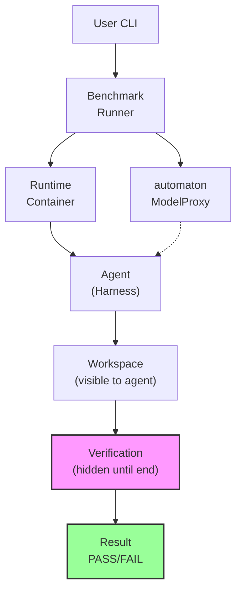
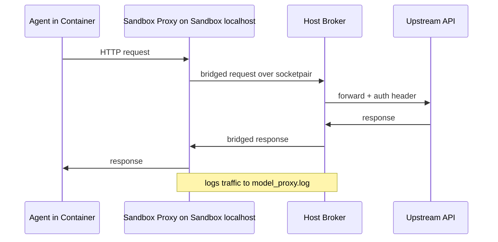
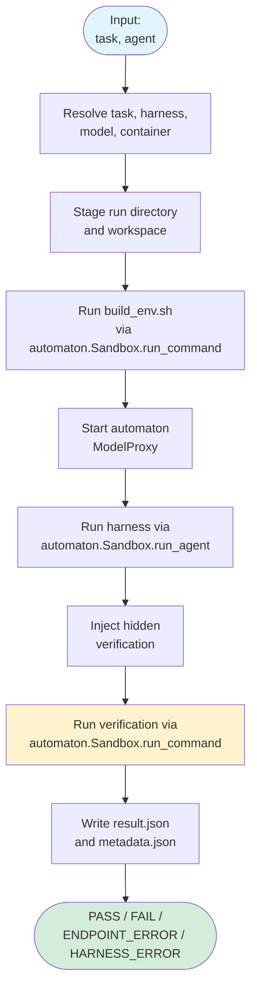

# Architecture

This page explains how ABC Bench is put together today.

## Overview

ABC Bench is a benchmark orchestrator built on the `automaton` engine. The
`automaton` library owns the sandboxed execution engine (`automaton.Sandbox`),
the loopback model proxy (`automaton.proxy.ModelProxy`), and the layered
container build mechanism (`automaton.ContainerManager`). abc_bench supplies its
container templates and task-group runtime layers to automaton's engine and
focuses on benchmark-specific concerns: tasks, hidden verification, PASS/FAIL
semantics, results, and orchestration.

The project is easiest to understand if you read it as a concrete pipeline rather than as an
abstract framework.

Each benchmark run combines four things:

- a task inside a resolved task group (`<group>/<task>/`)
- a harness under `harnesses/<harness>/`
- a runtime container built for `(harness, task_group)`
- hidden verification injected after the agent finishes



## The Main Pieces

The main benchmark-specific pieces, all of which abc_bench owns:

- tasks, grouped inside self-contained task groups (`<group>/<task>/`)
- harnesses, under `harnesses/<harness>/`
- layered runtime containers, built from ABC Bench templates plus each group's own template
- hidden verification, injected after the agent finishes

## Package Root vs. Task Groups

ABC Bench draws its runtime assets from two distinct places:

- The **package root** holds ABC Bench-owned assets: `harnesses/` and the base
  and harness container templates under `containers/`. It ships in the wheel and
  is resolved by `abc_bench.config.get_package_root`.
- **Task groups** (benchmarks) are *not* part of the package root. They are
  self-contained, external, installable directories discovered at runtime (see
  [Task Group Discovery](#task-group-discovery)). Only the tiny bundled
  `smoke_test` group ships in the wheel.

## Repository Layout

The package root is organized around the ABC Bench-owned pieces:

```text
harnesses/
  opencode/
  opencode-hybrid/

containers/
  base.Dockerfile.jinja2
  harnesses/
    opencode.Dockerfile.jinja2
    opencode-hybrid.Dockerfile.jinja2
```

A task group is a self-contained, relocatable directory that carries its own
runtime container template:

```text
<group>/
  group.yaml
  Dockerfile.jinja2
  <task>/
```

## Container Layering

Runtime containers are built in three layers:

```text
base -> harness -> task group
```

Concrete template sources:

```text
<package_root>/containers/
  base.Dockerfile.jinja2
  harnesses/
    opencode.Dockerfile.jinja2
    opencode-hybrid.Dockerfile.jinja2

<group_dir>/
  Dockerfile.jinja2          # the task-group runtime layer, inside the group
```

The base and harness templates are ABC Bench-owned and live in the package
root. The runtime (task-group) layer template lives inside the resolved group
directory as `Dockerfile.jinja2`, so a group ships its own runtime layer.

The runner never executes a harness-only container. It always uses the final
harness-plus-group runtime. That is one of the most important facts to keep in
mind when reading the rest of the codebase.

## Execution Model

The runner stages a fresh run directory, copies in the task workspace, runs the
task build step, runs the harness, injects hidden verification, and then runs
verification in the same runtime container. That common environment across the
whole run is deliberate.

## Main Components

### Runner

`abc_bench.runner.BenchmarkRunner` orchestrates the full benchmark lifecycle,
delegating sandboxed execution to the `automaton` engine.

`BenchmarkRunner` is the orchestration layer. It is responsible for the overall
control flow of a benchmark run, not for solving tasks itself.

Responsibilities:

- resolve the task and agent configuration
- create the run directory and stage runtime files
- run `build_env.sh` in the final runtime container via `automaton.Sandbox.run_command`
- start `automaton.proxy.ModelProxy`
- run the harness in the same runtime container via `automaton.Sandbox.run_agent`
- inject hidden verification files after the agent completes
- run verification via `automaton.Sandbox.run_command` and write `result.json`, `metadata.json`, and `usage.json`

### ModelProxy

`automaton.proxy.ModelProxy` is a split proxy provided by the `automaton` engine.
It gives the harness controlled access to the upstream model API while keeping
the harness in a loopback-only network namespace. The point is to keep the
model-facing agent from simply "leaving" the isolated benchmark container and
talking directly to arbitrary external services while still preserving access to
the configured model endpoint.



The proxy exists so that harnesses can talk to sandbox-local localhost while the
host side manages credentials and upstream network access.

Key properties:

- exposes sandbox-local localhost to the harness
- injects credentials on the host side
- keeps secrets out of task files
- logs traffic for debugging

For the split-proxy/socketpair internals and the sandbox-side injected helper,
see the Automaton documentation. The `automaton` engine handles the two-process
layout (host-side broker and sandbox-side helper serving `127.0.0.1:18080`)
while abc_bench stages the per-run directory and passes the proxy configuration
overrides to `automaton.Sandbox`.

### Task System

Tasks are filesystem-defined benchmark problems. They are not separate database
objects or registry entries; the directory structure is the definition. Tasks
live inside self-contained task groups:

```text
<group>/<task>/
  build_env.sh
  prompt.md
  workspace/
  verification/
```

The agent sees `prompt.md` and `workspace/`. It does not see `verification/`
until execution is finished. This hidden-verification structure is central to
how the project works.

#### Task Group Discovery

Task groups are not required to live in the source tree. They are discovered at
runtime by `abc_bench.groups.GroupResolver` from a prioritized set of *search
roots*, analogous to directories on the shell `PATH` (each root *contains* task
groups as `<root>/<group>/` or `<root>/<group>.sqfs`). Priority, highest first:

1. the `--task-dir <dir>` CLI flag
2. the colon-separated `TASK_PATH` environment variable (left-to-right)
3. the installed root `~/.abc-bench/tasks`, populated by `abc-bench install`

The first root that provides a given group id wins; lower-priority roots that
also define it are shadowed with a warning. `abc-bench install` materializes a
task group into the installed root from a directory, a `.sqfs` image, or a
`.tar.gz`/`.tgz` archive. The bundled `smoke_test` group is auto-installed on
first use.

A group may be delivered as a `<group>.sqfs` image, which is interchangeable
with a directory: ABC Bench mounts it read-only with `squashfuse` and copies it
to a temporary directory before use.

#### Heavy Benchmarks

Heavy benchmarks with large or generated workspaces are built and published from
a separate `benchmarks` monorepo and shipped as expanded workspaces inside a
task group, installed via `abc-bench install`. There is no runtime workspace
synthesis; every task ships an expanded `workspace/` on disk.

### Harness System

Harnesses define how a particular agent is invoked. They are the adapter layer
between ABC Bench's run protocol and the behavior of a specific agent tool.

Typical harness contents:

```text
harnesses/<harness>/
  harness.yaml
  run_benchmark.sh
  system_prompt.md
  ...
```

The harness script receives staged paths for:

- workspace
- task prompt
- system prompt
- models config
- harness config
- output directory
- timeout

The current repository ships four harnesses with that interface:

- `opencode`: single-agent OpenCode harness
- `opencode-hybrid`: planner/builder OpenCode harness that maps two configured
  models onto `plan_model` and `build_model` roles via `harness_config`
- `codex`: single-agent OpenAI Codex CLI harness, which feeds the prompt on
  stdin and captures Codex's JSONL event stream (see
  [Codex Harness](codex-harness.md))
- `claude-code`: single-agent Anthropic Claude Code CLI harness, which feeds the
  prompt on stdin, restricts the agent's tool set, and speaks the Anthropic
  Messages API (see [Claude Code Harness](claude-code-harness.md))

### Container Manager

`automaton.ContainerManager` provides the layered container build mechanism.
abc_bench's `abc_bench.container.ContainerManager` subclasses it and supplies a
`ContainerLayout`. The base and harness templates come from the package root
(`containers/base.Dockerfile.jinja2` and `containers/harnesses/`); the runtime
(task-group) layer template comes from the resolved group directory
(`<group_dir>/Dockerfile.jinja2`). The actual rendering, Charliecloud image
building, and runtime directory conversion are handled by automaton.

Built container artifacts live under:

```text
/var/tmp/abc-bench-{uid}/containers/
```

Shared Charliecloud image storage lives under:

```text
/var/tmp/abc-bench-{uid}/ch-image-storage/
```

## Execution Flow

The run itself is easier to follow in phases.

### 1. Setup

1. Resolve task from `--task` and optional `--task-group`
2. Resolve the selected agent into harness, models, and harness config
3. Resolve the final runtime container for `(harness, task.group_id)`
4. Create the result directory
5. Copy the task workspace into the run directory
6. Stage runtime files such as `prompt.md`, `build_env.sh`, and harness assets

### 2. Environment Build

7. Run `build_env.sh` inside the final runtime container via `automaton.Sandbox.run_command`
8. Create any task-local environment needed for the benchmark

### 3. Agent Execution

9. Start `automaton.proxy.ModelProxy`
10. Generate `models_config.yaml` and `harness_config.yaml` for the harness
11. If sandboxing is enabled, stage the sandbox helper and launch the harness in
    a loopback-only namespace with the helper serving sandbox-local localhost
12. Run the harness inside the same final runtime container via `automaton.Sandbox.run_agent`
13. Let the agent modify the staged workspace autonomously

### 4. Verification

14. Inject `verification/` into the result directory after the agent completes
15. Run `verification/verify_solution.sh` inside the same runtime container via `automaton.Sandbox.run_command`
16. When sandboxing is enabled, run verification through the same sandbox helper
    and namespace used for the harness
17. Parse PASS or FAIL from verification output

### 5. Results

18. Write `result.json`
19. Write `metadata.json`
20. Write `usage.json`

## Data Flow



## Result Layout

Results are organized by agent archive, task group, and task id:

```text
results/
  <agent_archive_dir>/
    <task-group>/
      <task-id>/
        <run>/
```

Each run directory contains the staged workspace, harness output, verification
artifacts, and machine-readable result metadata.

## Important Runtime Facts

- task paths are canonical in the filesystem
- metadata supplements paths but does not replace them
- runtime containers are harness-plus-group, not harness-only
- hidden verification is injected after agent execution, not exposed up front
- `build_env.sh` keeps host networking even when sandboxing is enabled
- harness and verification share the same loopback-only sandbox behavior by default
- live harness output still streams to the terminal in sandbox mode even though
  the helper also records it to per-run log files

## Build And CI Model

CI operations are documented in:

- `docs/developer-guide/ci-cd.md`

That page covers:

- the test job (editable install of the sibling `automaton` component + this
  project, then `pytest`)
- portable test-runner requirements, with container tools needed only for
  container integration checks
- a separate documentation runner, with optional publishing configured for
  the chosen hosting service

The sibling `../abc-ci` component provides CI orchestration; see its README
from the monorepo checkout. This component does not include deployment-specific
pipeline YAML.

Note that ABC Bench is not a published package: there is no wheel build and no
release flow.

## See Also

- [Adding Tasks](adding-tasks.md)
- [Adding Harnesses](adding-harnesses.md)
- [Container System](container-system.md)
- [API Reference](api-reference/index.md)
