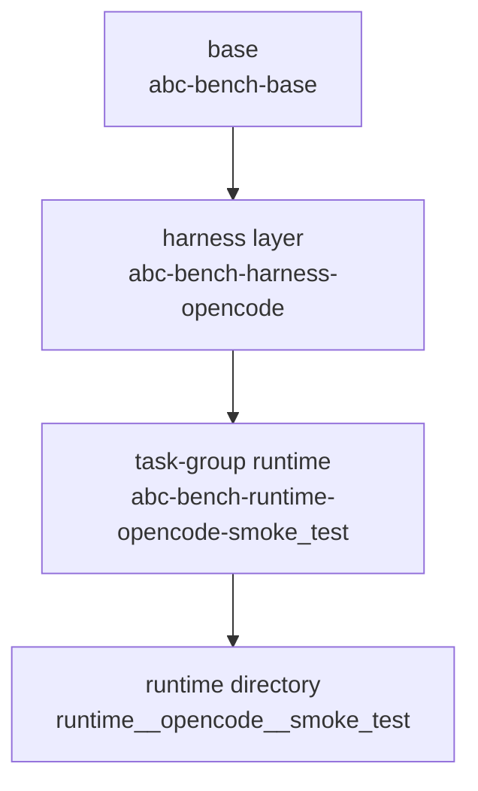

# Container System

This page explains the container system as it exists in this repository today.

## Overview

ABC Bench uses Charliecloud to provide reproducible software environments for
tasks and harnesses. The repository does not ask users to hand-author a separate
container for every benchmark. Instead, it builds runtimes from a small layered
system.

```text
base -> harness -> task group
```

The actual build engine is `automaton.ContainerManager`, which abc_bench
subclasses via `abc_bench.container.ContainerManager`. abc_bench supplies a
`ContainerLayout` to automaton's engine: the base and harness layers come from
the ABC Bench *package root*, while the runtime (task-group) layer comes from
the resolved task-group directory.

The important distinction is:

- harness layers are build artifacts
- harness-plus-group runtimes are what the runner actually executes

## Template Layout

The base and harness layer templates are ABC Bench-owned runtime assets. They
live under `containers/` in the *package root* (the directory holding
`harnesses/` and `containers/`, resolved by `abc_bench.config.get_package_root`):

```text
<package_root>/containers/
  base.Dockerfile.jinja2
  harnesses/
    <harness>.Dockerfile.jinja2
```

The runtime (task-group) layer template does **not** live in the package root.
It lives inside the resolved task-group directory as `Dockerfile.jinja2`, so each
group is a self-contained, relocatable unit:

```text
<group_dir>/
  group.yaml
  Dockerfile.jinja2          # the group's runtime container-layer template
  <task>/
```

A group may override the template filename by setting `container_template:` in
its `group.yaml` (interpreted relative to the group directory); the default is
`Dockerfile.jinja2`.

All sources are stored as `.jinja2` files so the parent-child relationship is
explicit.

## Build Artifacts

Shared Charliecloud image storage:

```text
/var/tmp/abc-bench-{uid}/ch-image-storage/
```

Built runtime directories:

```text
/var/tmp/abc-bench-{uid}/containers/
  base/
  harness__opencode/
  runtime__opencode__smoke_test/
```

## Build Order

The `automaton.ContainerManager` (subclassed by abc_bench) runs these steps:

1. render and build `<package_root>/containers/base.Dockerfile.jinja2`
2. render and build `<package_root>/containers/harnesses/<harness>.Dockerfile.jinja2`
3. render and build the resolved group's `<group_dir>/Dockerfile.jinja2`
4. convert each image into an unpacked runtime directory with `ch-convert`

## Image Naming

- base image: `abc-bench-base`
- harness image: `abc-bench-harness-<harness>`
- final runtime image: `abc-bench-runtime-<harness>-<group>`

The CLI exposes these as container refs:

- `base`
- `<harness>`
- `<harness>/<task-group>`

## Rendering Model

The container manager currently performs a minimal template substitution for:

```text
{{ parent_image }}
```

That is enough to express the current layering model without maintaining
separate handwritten Dockerfiles for each concrete runtime.

## Layering Diagram



## Why Shared Builder Storage Matters

Charliecloud builds rely on shared image storage under
`/var/tmp/abc-bench-{uid}/ch-image-storage/`.

That shared storage is what allows:

- harness templates to inherit from `abc-bench-base`
- a group's `Dockerfile.jinja2` to inherit from `abc-bench-harness-<harness>`

Without shared storage, the current layered build model would not work.

## Runtime Selection

When a benchmark runs, the runner resolves a final runtime from:

```text
(harness, task.group_id)
```

Examples:

- `opencode + smoke_test -> runtime__opencode__smoke_test`

The runner does not execute the harness layer directly. The harness layer exists
so task groups can add their own software on top of it.

## Runtime Behavior

The final runtime is reused for all three benchmark phases:

1. `build_env.sh`
2. harness execution
3. verification

This keeps the environment stable across the full run.

Shared base packages should include tools that agent runtimes depend on across
multiple harnesses. For example, OpenCode's `glob` and `grep` tools require
`ripgrep`, so `ripgrep` belongs in the base layer rather than being duplicated
across individual OpenCode harness templates.

## CI Relationship

Charliecloud appears in CI for normal benchmark/runtime container builds.

The package CI job itself is not wrapped in an extra outer Charliecloud
container. CI runs in the host environment and uses `ch-run` only where the
toolchain is actually needed.

## Important Notes

- task-group templates are currently assumed to be compatible with all harness templates
- built artifacts are independent after build; parent layers matter mainly during build
- the final runtime directory is what `ch-run` executes

## See Also

- [Managing Containers](../user-guide/managing-containers.md)
- [Development Container](dev-container.md)
- [Architecture](architecture.md)
- [CI/CD](ci-cd.md)
