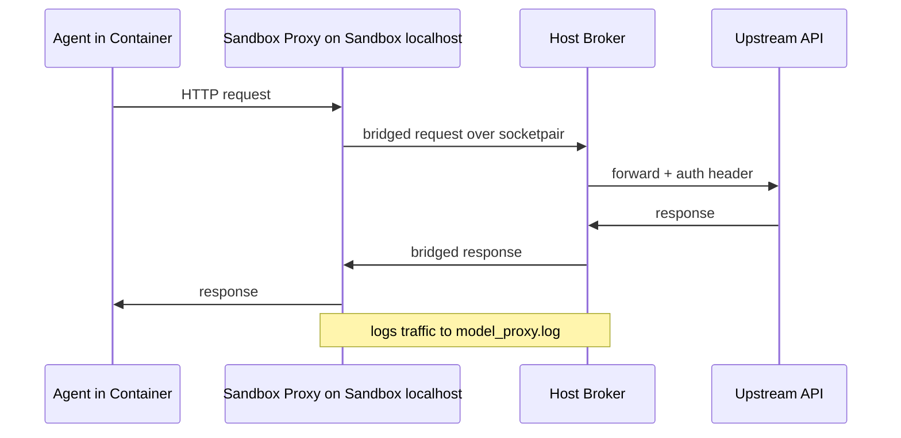

# Architecture

This page explains how Automaton is put together.

## Overview

At its core, Automaton is a sandbox execution engine. It stages a run, builds a
runtime container, runs a harness (an autonomous agent) inside it, and lets
callers run arbitrary code against the resulting workspace. The project is
easiest to understand as a pipeline rather than a framework.

Each run combines four things:

- a runtime container built for `(harness, runtime layer)`
- a harness loaded from an explicit directory you supply
- an agent (harness + models + harness config) resolved from `AutomatonConfig`
- staged workspace files and bind mounts supplied by the caller

## Main Components

### Sandbox

`automaton.sandbox.Sandbox` runs commands and agents inside a Charliecloud
container. It provides two entry points:

- `Sandbox.run_command` — run an arbitrary, non-agentic command inside the
  container. By default runs with loopback-only networking and no model proxy.
  This is the general-purpose path for running setup, tooling, or verification
  code against a workspace.
- `Sandbox.run_agent` — run an autonomous agent (a harness driving one or more
  models) inside the container, brokering all model traffic through a
  loopback-only `ModelProxy`. The agent's deliverable is left in the
  bind-mounted workspace directory. Returns an `ExecutionResult`.

### ModelProxy

`automaton.proxy.ModelProxy` is a split proxy used to give the harness
controlled access to the upstream model API while keeping the harness in a
loopback-only network namespace. The point is to keep the model-facing agent
from leaving the isolated container while still preserving access to the
configured model endpoint.



The proxy exists so that harnesses can talk to sandbox-local localhost while the
host side manages credentials and upstream network access.

The implementation is intentionally split across two processes:

- a host-side broker in `automaton.proxy.ModelProxy`
- a sandbox-side injected Python helper staged into the run directory and
  launched under `unshare --user --map-root-user --net --pid --mount-proc --fork`

The helper brings up `lo`, clears inherited proxy environment variables, serves
`127.0.0.1:18080` inside the sandbox namespace, and bridges HTTP requests over
an inherited `socketpair()` back to the host broker.

The engine-local identifiers are configurable on `Sandbox` and default to:

| Identifier | Constant | Default |
|------------|----------|---------|
| Proxy API key env var | `DEFAULT_PROXY_API_KEY_ENV` | `AUTOMATON_MODEL_PROXY_API_KEY` |
| Proxy API key value | `DEFAULT_PROXY_API_KEY_VALUE` | `automaton-proxy` |
| Proxy provider id | `DEFAULT_PROXY_PROVIDER_ID` | `automaton-proxy` |
| Sandbox-local proxy port | `DEFAULT_SANDBOX_PROXY_PORT` | `18080` |

The sandbox helper environment variables are:

- `AUTOMATON_PROXY_FD` — the `socketpair()` file descriptor
- `AUTOMATON_SANDBOX_PROXY_PORT` — the loopback port the sandbox proxy listens on
- `AUTOMATON_SANDBOX_CMD` — the harness command to execute (JSON-encoded)
- `AUTOMATON_SANDBOX_LOG` — the harness log file path

Key properties:

- exposes sandbox-local localhost to the harness
- injects credentials on the host side, replacing any client-sent
  `Authorization` or `x-api-key` header rather than forwarding both
- selects the credential scheme from the model's configured `api` style
  (`anthropic_messages` uses `x-api-key` plus `anthropic-version`; the OpenAI
  styles use `Authorization: Bearer`)
- keeps secrets out of task files
- logs traffic for debugging
- retries dropped upstream requests within a bounded deadline
- refuses requests that declare provider-executed tools unless explicitly
  allowed (see below)

#### Provider-executed tool policy

Some agents declare tools that the **model provider** executes, rather than the
agent executing them in the sandbox. On the wire these appear as a bare
capability (`{"type": "web_search"}`) instead of a callable function
(`{"type": "function", "name": ..., "parameters": ...}`).

This distinction is a containment boundary, not a stylistic one:

| | locally executed tool | provider-executed tool |
|---|---|---|
| where it runs | in the container | on the provider's infrastructure |
| confined by the network namespace | yes | **no** |
| visible in `model_proxy.log` | as its own request | no — folded into one ordinary 200 |
| visible in the harness transcript | yes | no |

Because the work happens inside the model's HTTP response, no connection leaves
the container, so the sandbox's loopback-only namespace has nothing to filter.
Remote content can be retrieved, and prompt content can leave inside a
provider-side query. For suites that run sensitive or export-controlled code this
is an untraceable egress path.

The proxy therefore **blocks these before opening the upstream connection**
unless the caller opts in:

```python
Sandbox(allowed_provider_executed_tools={"web_search"})
```

or, via configuration:

```yaml
defaults:
  allowed_provider_executed_tools:
    - web_search
```

The check **fails closed**: a tool whose `type` is unrecognized *and* which
carries no local call signature (a `name` plus `parameters`/`input_schema`) is
treated as provider-executed, so a native tool introduced by a future agent
release is blocked rather than silently forwarded. Responses `namespace` tools
are recursed into so a native tool cannot hide inside one.

A blocked request yields an HTTP `403` to the sandbox (the broker answers, rather
than leaving the agent on a socket that never replies), a
`[tool-policy] BLOCKED` line in `model_proxy.log`, and
`blocked_provider_executed_tools` on both the proxy and the `ExecutionResult`.
Callers should treat a non-empty value as a configuration/containment failure
rather than an ordinary task failure — including when the agent retries without
the tool and exits `0`.

See `automaton.proxy.PROVIDER_EXECUTED_TOOL_TYPES` for the recognized types.

### Container Manager

`automaton.container.ContainerManager` renders templates, builds Charliecloud
images, and converts them into runtime directories.

Built container artifacts live under:

```text
/var/tmp/automaton-{uid}/containers/
```

Shared Charliecloud image storage lives under:

```text
/var/tmp/automaton-{uid}/ch-image-storage/
```

The cache root can be overridden via the `AUTOMATON_CONTAINER_BASE` environment
variable. See [Container System](container-system.md) for the layered build
mechanism.

### Configuration

`automaton.config.AutomatonConfig` loads and manages provider-based model
configuration from a YAML file. Providers define API endpoints and
authentication once, then models reference providers by name. The config lives
at `~/.automaton/config.yaml` by default. See
[Configuration](configuration.md) for the config shape.

### Harness

`automaton.harness.Harness` represents how an autonomous agent is invoked: a run
script, prompts, and harness-specific metadata. Harnesses are loaded from an
explicit directory supplied by the caller. The container recipe is not owned by
the harness directory; it is supplied to `ContainerManager` through a
`ContainerLayout`.

### Agent

`automaton.agent.Agent` resolves a named agent definition into a harness, models,
and a harness config blob. It is constructed from an `AutomatonConfig`.

## Execution Flow

### 1. Setup

1. Resolve the agent from `AutomatonConfig` into harness, models, and harness config
2. Resolve the final runtime container for `(harness, runtime layer)`
3. Create the run directory
4. Stage workspace files, prompts, harness assets, and the sandbox helper script

### 2. Agent Execution

5. Start `ModelProxy`
6. Generate `models_config.yaml` and `harness_config.yaml` for the harness
7. If sandboxing is enabled, stage the sandbox helper and launch the harness in
   a loopback-only namespace with the helper serving sandbox-local localhost
8. Run the harness inside the same runtime container
9. Let the agent modify the staged workspace autonomously

### 3. Caller Verification

10. After the agent completes, the caller runs verification via
    `Sandbox.run_command` in the same runtime container

## The clean ch-run environment

When `Sandbox` invokes `ch-run`, it sets up a clean environment with only the
necessary variables:

```text
PATH=/opt/conda/bin:/usr/local/bin:/usr/bin:/bin
HOME=/var/tmp/automaton-home
SSL_CERT_FILE=/etc/ssl/certs/ca-certificates.crt
REQUESTS_CA_BUNDLE=/etc/ssl/certs/ca-certificates.crt
CURL_CA_BUNDLE=/etc/ssl/certs/ca-certificates.crt
CONDA_PLUGINS_AUTO_ACCEPT_TOS=yes
```

All other environment variables are unset (`--unset-env=*`), and caller-supplied
bind mounts are added explicitly.

## Memory limits

`Sandbox` can cap harness and command memory usage. By default, the harness is
capped at 90% of available memory (read from cgroup or `/proc/meminfo`). This
can be overridden with an absolute byte limit via
`harness_memory_limit_bytes`, or by setting
`harness_memory_limit_fraction` to `None` to disable the limit.

## ExecutionResult

`Sandbox.run_agent` returns an `ExecutionResult` containing execution facts:

- `success` — whether the harness exited cleanly
- `returncode` — harness exit code
- `workspace` — host path to the deliverable workspace
- `endpoint_exhausted` — whether the model proxy could not obtain a complete
  upstream response
- `failure_detail` — failure detail when `success` is `False`
- `proxy_error_detail` — last upstream/model proxy error, if any
- `usage_records` — per-request usage/cost accounting records from the proxy
- `usage_summary` — aggregated usage summary
- `log_file` — path to the harness process log
- `blocked_provider_executed_tools` — provider-executed tool types the proxy
  refused to forward; non-empty means the run should not be graded
- `dry_run` — whether this was a dry run

Automaton is agnostic about the deliverable's contents; it reports only
execution facts and the workspace location.

## See also

- [Overview](overview.md)
- [Container System](container-system.md)
- [Configuration](configuration.md)
- [Harness Interface](harness-interface.md)
- [API Reference](../api-reference/index.md)
