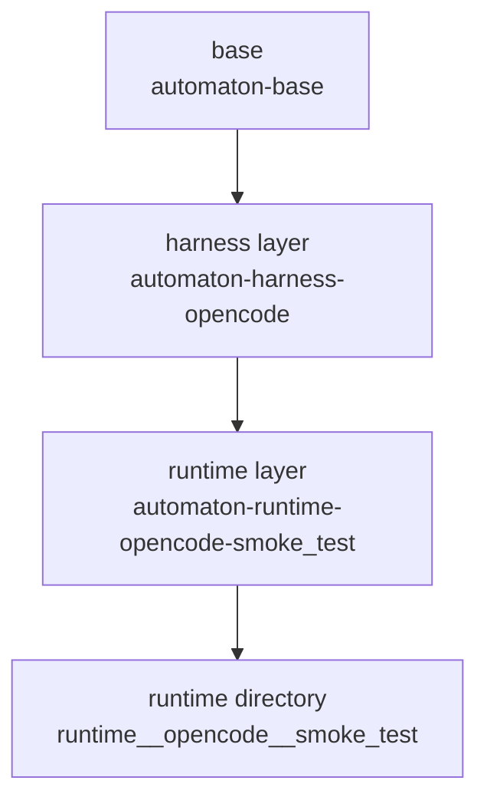

# Container System

This page explains the Automaton container system.

## Overview

Automaton uses Charliecloud to provide reproducible software environments for
sandboxed agent and command execution. Instead of asking callers to hand-author
a separate container for every use, it builds runtimes from a small layered
system.

```text
base -> harness -> runtime layer
```

The important distinction is:

- harness layers are build artifacts
- harness-plus-runtime runtimes are what `Sandbox` actually executes

## ContainerLayout

Automaton is content-free: it does not know where templates live or what runtime
layers exist. Callers supply a `ContainerLayout` describing:

- the base Dockerfile template
- how to find a harness's Dockerfile template and enumerate harnesses
- how to enumerate runtime layers and find their Dockerfile templates and
  metadata

The runtime layer is fully generic here. A benchmark orchestrator might back it
with "task groups", but Automaton assigns no such meaning.

### Layout fields

| Field | Type | Description |
|-------|------|-------------|
| `base_template_path` | `Path` | Path to the base Dockerfile template (rendered with `{{ parent_image }}`) |
| `harness_template_path` | `Callable[[str], Path]` | Given a harness template name, return its Dockerfile template path |
| `list_harnesses` | `Callable[[], list[str]]` | Return the available harness ids |
| `load_harness` | `Callable[[str], Harness]` | Given a harness id, return a loaded `Harness` (the manager reads its `container_template`) |
| `list_runtime_layers` | `Callable[[], list[str]]` | Return the available runtime-layer ids |
| `runtime_layer_metadata` | `Callable[[str], dict]` | Given a runtime-layer id, return its metadata dict (reads optional `container_template` key, defaults to the layer id) |
| `runtime_template_path` | `Callable[[str], Path]` | Given a runtime-layer template name, return its Dockerfile template path |

## Build Artifacts

Shared Charliecloud image storage:

```text
/var/tmp/automaton-{uid}/ch-image-storage/
```

Built runtime directories:

```text
/var/tmp/automaton-{uid}/containers/
  base/
  harness__<harness>/
  runtime__<harness>__<runtime-layer>/
```

The cache root can be overridden via the `AUTOMATON_CONTAINER_BASE`
environment variable:

```bash
export AUTOMATON_CONTAINER_BASE=/scratch/${USER}/automaton-containers
```

## Image Naming

The image prefix is configurable on `ContainerManager` (default
`"automaton"`):

- base image: `automaton-base`
- harness image: `automaton-harness-<harness>`
- final runtime image: `automaton-runtime-<harness>-<runtime-layer>`

The CLI exposes these as container refs:

- `base`
- `<harness>`
- `base/<harness>`
- `<harness>/<runtime-layer>`
- `base/<harness>/<runtime-layer>`

## Rendering Model

The container manager performs a minimal template substitution for:

```text
{{ parent_image }}
```

That is enough to express the current layering model without maintaining
separate handwritten Dockerfiles for each concrete runtime.

## Layering Diagram



## Build Order

1. render and build the base Dockerfile template
2. render and build the harness Dockerfile template
3. render and build the runtime-layer Dockerfile template
4. convert each image into an unpacked runtime directory with `ch-convert`

## Runtime Selection

When a run executes, the caller resolves a final runtime from:

```text
(harness, runtime_layer)
```

Examples:

- `opencode + smoke_test -> runtime__opencode__smoke_test`
- `opencode + fortran_transpilation -> runtime__opencode__fortran_transpilation`

The caller does not execute the harness layer directly. The harness layer
exists so runtime layers can add their own software on top of it.

## Runtime Behavior

The final runtime is reused across whatever phases the caller needs — typically
at minimum:

1. setup/build commands via `Sandbox.run_command`
2. harness execution via `Sandbox.run_agent`
3. verification via `Sandbox.run_command`

This keeps the environment stable across the full run.

Shared base packages should include tools that agent runtimes depend on across
multiple harnesses. For example, if a harness uses `grep` or `glob` tools that
require `ripgrep`, then `ripgrep` belongs in the base layer rather than being
duplicated across individual harness templates.

## Why Shared Builder Storage Matters

Charliecloud builds rely on shared image storage under
`/var/tmp/automaton-{uid}/ch-image-storage/`.

That shared storage is what allows:

- harness templates to inherit from `automaton-base`
- runtime-layer templates to inherit from `automaton-harness-<harness>`

Without shared storage, the current layered build model would not work.

## Important Notes

- runtime-layer templates are assumed to be compatible with all harness
  templates
- built artifacts are independent after build; parent layers matter mainly
  during build
- the final runtime directory is what `ch-run` executes

## See also

- [Architecture](architecture.md)
- [Overview](overview.md)
- [Configuration](../api-reference/automaton.container.md)
