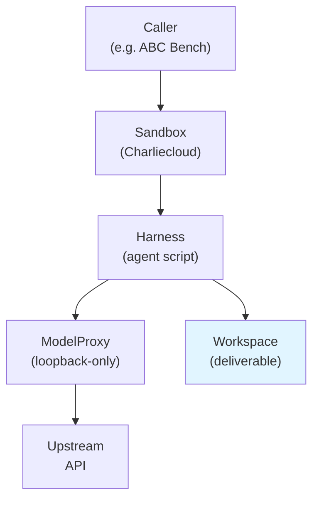

# Overview

This page explains the mental model behind Automaton.

## The core idea

Automaton is an **engine**, not a benchmark. It runs an autonomous agent (a
harness driving one or more models) inside a hardened Charliecloud container,
and it also provides a generic path to run arbitrary non-agentic code in the
same container. It does none of the content decisions itself — no tasks, no
harnesses, no container templates. A caller (such as ABC Bench) supplies
those as inputs and decides what a "deliverable" means and how to verify it.

## Architecture at a glance



## Container layering

Containers are built in three layers:

```text
base -> harness -> runtime layer
```

- The **base** layer provides the shared OS and tooling.
- The **harness** layer adds the agent tool and its dependencies.
- The **runtime layer** is fully generic — a benchmark might back it with
  "task groups", but Automaton assigns that meaning.

See [Container System](container-system.md) for the build mechanism.

## The sandbox model

Each run executes inside a Charliecloud container with a clean, minimal
environment. When sandboxing is enabled, the harness runs inside an isolated
network namespace (`unshare --user --map-root-user --net --pid --mount-proc --fork`) with no
outbound network access — model traffic is routed through a loopback-only
model proxy that the host broker provides.

The sandbox-local proxy serves `127.0.0.1:18080` and bridges requests over an
inherited `socketpair()` back to the host-side broker, which forwards them to
the upstream model API, injects authentication credentials, honors provider TLS
configuration, and retries dropped upstream requests within a bounded deadline.

This split design keeps secrets out of task files, keeps the model-facing agent
from leaving the isolated container, and gives the caller a clean place to
inspect live proxy errors and usage accounting.

## Two execution modes

### `Sandbox.run_agent`

Runs an autonomous agent (a harness driving one or more models) inside the
container. The agent's deliverable is left in the bind-mounted workspace
directory. Returns an `ExecutionResult`.

### `Sandbox.run_command`

Runs an arbitrary, non-agentic command inside the container. By default runs
with loopback-only networking and no model proxy. This is the general-purpose
path for running setup, tooling, or verification code against a workspace.
A caller typically uses this to verify a deliverable after the agent run.

## Content-free by design

Automaton ships no concrete harnesses, container templates, or tasks. Callers
supply:

- a `ContainerLayout` describing where templates live and what runtime layers
  exist
- a `Harness` (loaded from an explicit directory) defining how an agent is
  invoked
- an `AutomatonConfig` naming providers, models, agents, and harnesses
- staged workspace files, bind mounts, and run assets

This makes Automaton reusable as the engine for projects like ABC Bench, and
keeps it content-free as a standalone library.

## See also

- [Architecture](architecture.md)
- [Container System](container-system.md)
- [Configuration](configuration.md)
- [Harness Interface](harness-interface.md)
- [API Reference](../api-reference/index.md)
